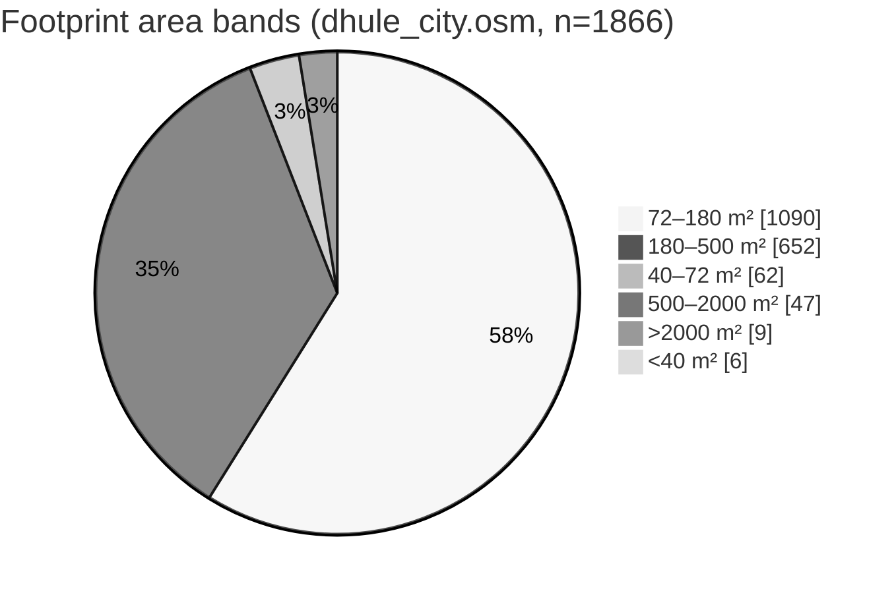

# 54 — Complete Dhule building data audit (Phase 2H.1)

Research only. No new buildings, no Blosm rewrite, no road/spawn/vehicle changes.

**Baseline:** `2cf17fa`. **Repro:** `python scripts/dev/audit_dhule_building_data.py`  
**Outputs:** `blender_work/dhule_city_pipeline/audit/complete_building_data_audit.json`, `complete_building_ways.csv`, `named_buildings.csv`, `building_glb_inventory.csv`.

Projection matches the game: origin 20.902 N, 74.777 E, 111,320 m/deg lat, X east, Z south. Spawn stays (−636.54, 881.83).

## Verdict

The production building source of truth is `assets/maps/dhule_city.osm` (1,866 ways) feeding the joined Blosm mesh. Almost every footprint is `building=yes` with no height, roof, shop, amenity, or office tag. Only 16 ways have a verified non-`yes` building type; only 22 have a name; only 3 have `building:levels`; **0** have `height`. Blosm correspondence is already measured (1,730 matched ids, 136 without confident triangles, 4,922 unresolved triangles). Downloaded GLBs that are true building candidates are few: mainly `indian_house.glb`, shop carts, and the architecture prototype — not a full kit for 1,866 footprints.

## 1. Sources and integrity

| File | Role | SHA-256 | Buildings |
| --- | --- | --- | ---: |
| `assets/maps/dhule_city.osm` | Blosm / partition source | `a6e346aa…754b97c` (unchanged vs doc 36) | **1,866** |
| `assets/maps/dhulemap.osm` | Broader map extract (roads/POIs too) | measured this run | **254** (all 254 ids ⊆ city set) |
| `assets/maps/dhule_roads_game.json` | Playable AABB boxes, not rings | read-only | **780** boxes |
| `assets/models/environments/dhule_blosm_city.glb` | Production joined city | `fe778f2e…d7393d` (unchanged) | n/a (2 meshes) |

Validation this run:

| Check | Result |
| --- | --- |
| City building count | 1,866 (reproducible) |
| Duplicate way ids | 0 |
| Missing node refs | 0 |
| Invalid / self-intersecting rings | 0 |
| Manifest ids == city OSM ids | yes (1,866) |
| Production OSM / Blosm / roads / `main.tscn` modified | no |

`dhulemap.osm` adds richer tags on the overlapping 254 ways (`amenity`, `office`, address fields). It does **not** replace `dhule_city.osm` for Blosm. 1,612 city buildings have no counterpart row in `dhulemap.osm`.

## 2. Tag coverage (`dhule_city.osm`)

Tag keys present on building ways: **`building` (1,866), `name` (22), `building:levels` (3).**  
Absent on every city building way: `height`, `roof:shape`, `roof:levels`, `shop`, `amenity`, `office`, `industrial`.

| `building=*` | Count |
| --- | ---: |
| `yes` | 1,850 |
| `school` | 4 |
| `apartments` | 3 |
| `college` | 2 |
| `residential` | 2 |
| `commercial` | 2 |
| `house` | 2 |
| `hospital` | 1 |

Playable JSON boxes (780): kinds `yes` 765, `school` 7, `residential` 4, `commercial` 4 — still axis-aligned `{w,d,h}`, not OSM rings.

## 3. Categories (evidence-based)

Classification uses **explicit tags only**. A name string never creates shop/public/religious classes.

### From `dhule_city.osm` (Blosm source)

| Category | Count | Evidence |
| --- | ---: | --- |
| unknown_or_unclassified | 1,850 | `building=yes` (or other unmapped) with no shop/amenity/office |
| school | 6 | `building=school` or `college` |
| apartment | 3 | `building=apartments` |
| family_house | 2 | `building=residential` |
| commercial_building | 2 | `building=commercial` |
| small_residential_house | 2 | `building=house` |
| hospital | 1 | `building=hospital` |
| commercial_shop / office / industrial / religious / row_house / other_public | **0** | no supporting tags in this file |

Named temples, gurdwara, court, theatre, etc. remain **unknown_or_unclassified** in the city extract because they are tagged `building=yes` only. That is intentional.

### From `dhulemap.osm` (254 overlapping ways — richer tags)

| Category | Count | Evidence examples |
| --- | ---: | --- |
| unknown_or_unclassified | 242 | still mostly `building=yes` |
| office | 3 | `office=newspaper|lawyer|government` |
| other_public | 3 | `amenity=courthouse` / `cinema` |
| family_house | 2 | `building=residential` |
| commercial_building | 2 | `building=commercial` |
| school | 2 | `building=school` |

Use map tags as **supplementary identity**, not as a second mesh source, until a controlled retag merge is designed.

## 4. Footprint geometry and heights

All 1,866 city rings are closed and valid under the game projection.

| Metric | Value |
| --- | ---: |
| Area min / median / mean / max (m²) | 20.8 / **156.2** / 214.5 / **17,177.8** (Sessions Court outline) |
| p10 / p25 / p75 / p90 (m²) | 84.4 / 114.7 / 223.1 / 326.1 |
| Typical span median X × Z (m) | 16.2 × 15.1 |
| Quadrilaterals | 1,514 |
| Non-quad (5–32 verts) | 352 |
| `building:levels` present | **3** (0.16%) |
| `height` present | **0** (**100%** unknown height in source) |
| `roof:*` present | 0 |

Area bands (size only — **not** a type claim):

| Band | Count | Note |
| --- | ---: | --- |
| under 40 m² | 6 | tiny sheds / fragments possible |
| 40–72 m² | 62 | small-house scale |
| 72–180 m² | 1,090 | dominant band |
| 180–500 m² | 652 | larger plots / multi-wing |
| 500–2000 m² | 47 | institutions / big footprints |
| over 2000 m² | 9 | includes court, colleges, large compounds |

**Estimated heights** (used in earlier prototypes from area heuristics) are **not** source heights. This audit does not assign random floors. Source-provided floors:

| OSM id | Name | `building` | `building:levels` | Area m² |
| --- | --- | ---: | ---: | ---: |
| 482797271 | Jai Hind College | college | 4 | 8,769 |
| 1193593171 | Dr Babasaheb Ambedkar High School, Dhule | school | 2 | 2,261 |
| 1276028477 | Rachana Hall | commercial | 2 | 375 |

## 5. Named buildings (`dhule_city.osm`)

22 named ways. Nearest to spawn: **Dhule District & Sessions Court** (`482794524`), 17,178 m², ~126 m from spawn — courtyard-scale outline, not a solid fill candidate without hole handling.

| OSM id | Name | `building` | Category (city tags) | Area m² | Dist spawn m |
| --- | --- | --- | --- | ---: | ---: |
| 482794524 | Dhule District & Sessions Court | yes | unknown_or_unclassified | 17177.8 | 126 |
| 482794972 | Malhar Bhaskar Deshpande | yes | unknown_or_unclassified | 713.2 | 272 |
| 1276031266 | Muncipal corporation Dhule | yes | unknown_or_unclassified | 3623.4 | 1144 |
| 1098919783 | Universal Fitness Club | yes | unknown_or_unclassified | 212.2 | 1157 |
| 1276032398 | Swastik Theatre | yes | unknown_or_unclassified | 840.1 | 1245 |
| 1276032689 | New City High School | school | school | 146.6 | 1272 |
| 1276126020 | New City High School | school | school | 146.6 | 1304 |
| 1276034799 | Apala Maharashtra Paper Office | yes | unknown_or_unclassified | 168.4 | 1375 |
| 1276027539 | Radhey Apartment | residential | family_house | 157.1 | 1387 |
| 1276027884 | Pitru Chhaya Apartment | residential | family_house | 368.8 | 1412 |
| 1276029311 | Adivasi Vikas Prakalpa Office | commercial | commercial_building | 112.7 | 1443 |
| 1276030150 | Prakash Cinema Theatre | yes | unknown_or_unclassified | 649.3 | 1512 |
| 1276028477 | Rachana Hall | commercial | commercial_building | 375.3 | 1577 |
| 1193592151 | Dr Babasaheb Ambedkar Memorial College of Law, Deopur | college | school | 1406.5 | 1832 |
| 1193593171 | Dr Babasaheb Ambedkar High School, Dhule | school | school | 2260.9 | 1934 |
| 482797271 | Jai Hind College | college | school | 8769.1 | 2415 |
| 548119409 | Gurudwara | yes | unknown_or_unclassified | 3730.5 | 2613 |
| 1098919784 | North Point School | school | school | 3384.2 | 3136 |
| 1340697207 | Gajanan Maharaj Mandir | yes | unknown_or_unclassified | 369.0 | 3311 |
| 1249399822 | Hanuman mandir | yes | unknown_or_unclassified | 111.4 | 3482 |
| 1162012870 | Ganesh Temple | yes | unknown_or_unclassified | 975.5 | 3629 |
| 1162006784 | Sai Ganesh Temple | yes | unknown_or_unclassified | 1901.9 | 3734 |

Full CSV: `audit/named_buildings.csv`.

## 6. Blosm correspondence

Production GLB nodes: `dhule_city.osm_buildings`, `dhule_city.osm_water`. **No way ids in mesh extras.** Matching is offline via `partition_buildings.py` (docs 35–36).

| Item | Count |
| --- | ---: |
| Source building triangles | 25,251 |
| Confidently assigned | 20,329 |
| Unresolved | 4,922 |
| Exported / matched OSM ids | **1,730** |
| Footprints with no confident triangles | **136** (class B: mesh exists, fails 0.20 m vertex rule) |
| Water triangles (separate) | 830 |
| Crossing / multi-footprint / ambiguous (subset of unresolved) | see doc 36 |

Unresolved reasons (export manifest): `crosses_boundary` 2,476, `unmatched` 2,412, `ambiguous_multi_footprint` 28, `ambiguous_margin` 6.

**Do not** reassign unresolved triangles to an OSM id without a new evidence rule. Archive GLBs live under `blender_work/dhule_city_pipeline/export/buildings/` (1,730 files, `.gdignore`). One-node-per-id runtime remains too expensive on Intel UHD 620 (~2,499 draws).

## 7. Downloaded / kit GLB inventory (building-related)

Audit listed 13 building-related paths (incoming duplicates included). Vehicles/roads/props were excluded unless city/building-named. Partition per-id archive is summarized separately (1,730), not re-inventoried.

| File | Category | Raw AABB (m) | Meshes | Complete building? | OSM footprint suitability |
| --- | --- | --- | ---: | --- | --- |
| `kit/buildings/indian_house.glb` | residential_house | ~5×5×5.16 | 2 | yes | **candidate with fitter** |
| `kit/buildings/bhelpuri_shop.glb` (+ copies) | commercial_shop_prop | raw Sketchfab hundreds of units | 14 | stall/cart | limited small verge only (normalize first) |
| `models/environments/dhule_blosm_city.glb` | city_mesh | district-scale | 2 | joined city | production mesh; not per-footprint |
| `maps/dhule_blosm.glb` | city_or_block_mesh | same scale as production | 2 | joined | duplicate/reference — do not treat as second city |
| `prototypes/dhule_block/dhule_block.glb` | city_or_block_mesh | ~874×11×1157 | 67 | block | not single OSM asset |
| `models/environments/dhule_junction_streetscape.glb` | streetscape | 48×14.5×48 | 55 | set | environment, not footprint fill |
| `incoming/mumbai_city.glb` / `city_map_free.glb` / `old_city.glb` | reference city meshes | large / non-Dhule | many | no | **not** for Dhule OSM ids |
| `dhule_architecture_test.glb` | architecture_prototype | large combined export | 26 | yes (selected ids) | **matched ids only** (Phase 35) |

Suitable next-kit work is narrow: scale-correct houses for ~72–180 m² bands, optional shop fronts where tags exist, institution shells only when `building`/`amenity` evidence exists. Do not scatter Mumbai/old_city meshes onto Dhule footprints.

## 8. Known limitations

1. **99%+ of Blosm footprints lack type and height** — any facade system must mark estimated floors separately from source.
2. **Names ≠ typology** — temples/court/cinema stay unclassified in city OSM until tags are added from verified sources (e.g. merge selected `dhulemap.osm` amenity/office tags).
3. **`building=residential` apartments by name** stay `family_house` under the no-name-inference rule; only `building=apartments` counts as apartment.
4. **No row-house / industrial evidence** in the city extract.
5. **Court and other compounds** are outer rings; solid extrusion invents courtyard fill.
6. **Playable JSON 780 boxes** ≠ 1,866 rings; prototypes must keep reading OSM.
7. **Blosm has no per-building id** at runtime; swaps need the partition archive + unresolved policy.
8. **Shop GLB raw units are not metres** until AssetKit normalize.

## 9. Recommended next steps (Phase 2H.2+)

1. Keep Blosm joined mesh as production collision/visual until chunked identity shipping is designed.
2. Optionally merge **tag-only** enrichments from `dhulemap.osm` (amenity/office) onto the 254 shared ids — no geometry rewrite.
3. Build a verified style kit for the **72–180 m²** band first (dominant count), with estimated vs source height fields.
4. Reserve named institutions for hand-authored or tagged replacements; never invent shop names.
5. Do not import Mumbai/old_city/junction sets as Dhule buildings.
6. Only after fitter + clearance + collision validation (Phase 2F/2G rules) place any kit house on an OSM ring.

## Left unchanged

`scenes/main.tscn`, `scripts/player_car.gd`, `scripts/asset_kit.gd` (local WIP preserved unstaged), roads JSON, spawn, Blosm GLB, OSM files.
